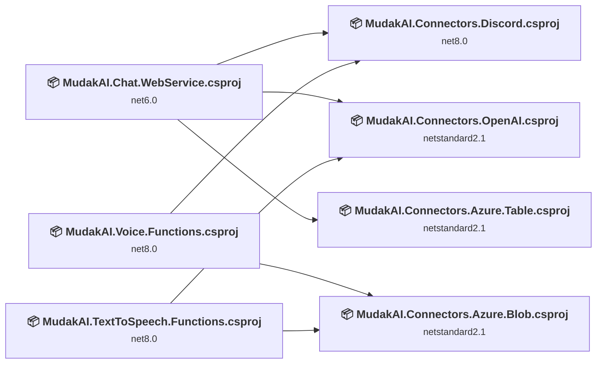
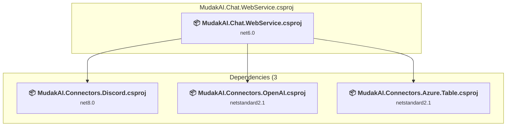
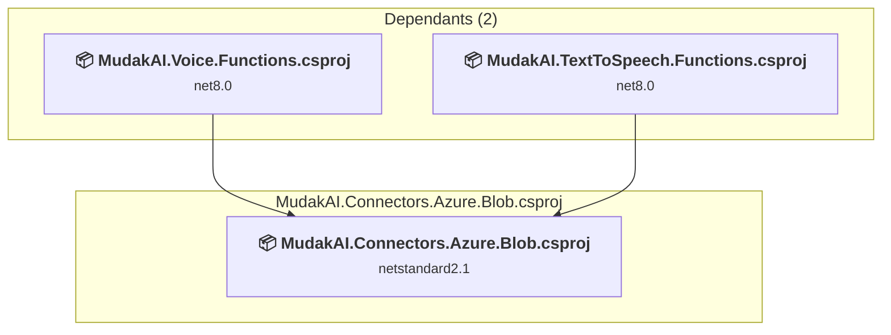
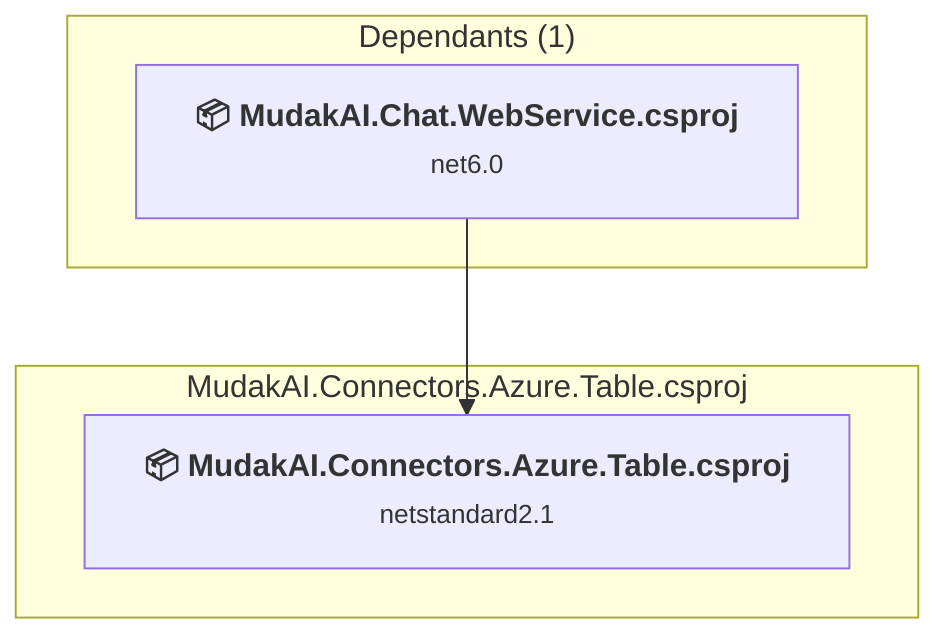
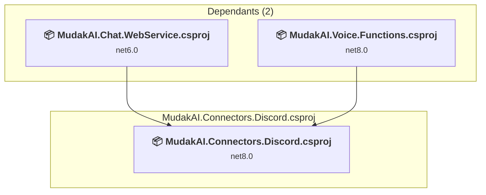
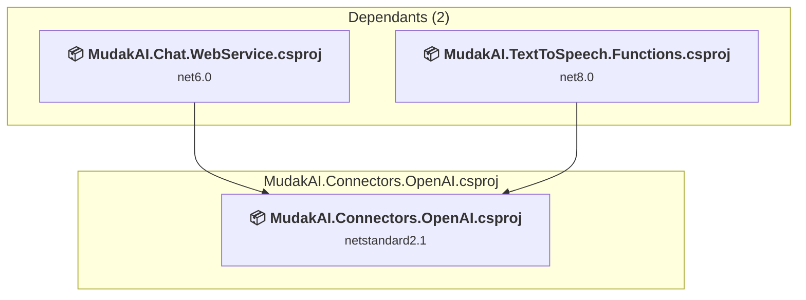
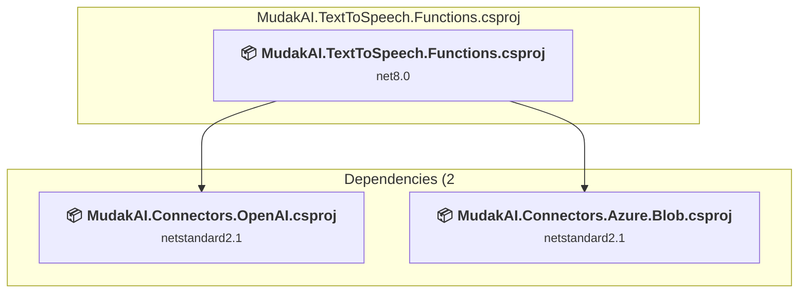
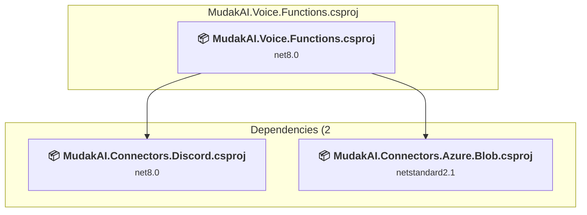

# Projects and dependencies analysis

This document provides a comprehensive overview of the projects and their dependencies in the context of upgrading to .NETCoreApp,Version=v8.0.

## Table of Contents

- [Executive Summary](#executive-Summary)
  - [Highlevel Metrics](#highlevel-metrics)
  - [Projects Compatibility](#projects-compatibility)
  - [Package Compatibility](#package-compatibility)
  - [API Compatibility](#api-compatibility)
- [Aggregate NuGet packages details](#aggregate-nuget-packages-details)
- [Top API Migration Challenges](#top-api-migration-challenges)
  - [Technologies and Features](#technologies-and-features)
  - [Most Frequent API Issues](#most-frequent-api-issues)
- [Projects Relationship Graph](#projects-relationship-graph)
- [Project Details](#project-details)

  - [MudakAI.Chat.WebService\MudakAI.Chat.WebService.csproj](#mudakaichatwebservicemudakaichatwebservicecsproj)
  - [MudakAI.Connectors.Azure.Blob\MudakAI.Connectors.Azure.Blob.csproj](#mudakaiconnectorsazureblobmudakaiconnectorsazureblobcsproj)
  - [MudakAI.Connectors.Azure.Table\MudakAI.Connectors.Azure.Table.csproj](#mudakaiconnectorsazuretablemudakaiconnectorsazuretablecsproj)
  - [MudakAI.Connectors.Discord\MudakAI.Connectors.Discord.csproj](#mudakaiconnectorsdiscordmudakaiconnectorsdiscordcsproj)
  - [MudakAI.Connectors.OpenAI\MudakAI.Connectors.OpenAI.csproj](#mudakaiconnectorsopenaimudakaiconnectorsopenaicsproj)
  - [MudakAI.TextToSpeech.Functions\MudakAI.TextToSpeech.Functions.csproj](#mudakaitexttospeechfunctionsmudakaitexttospeechfunctionscsproj)
  - [MudakAI.Voice.Functions\MudakAI.Voice.Functions.csproj](#mudakaivoicefunctionsmudakaivoicefunctionscsproj)

## Executive Summary

### Highlevel Metrics

| Metric | Count | Status |
| :--- | :---: | :--- |
| Total Projects | 9 | 6 require upgrade |
| Total NuGet Packages | 29 | 5 need upgrade |
| Total Code Files | 33 |  |
| Total Code Files with Incidents | 6 |  |
| Total Lines of Code | 2013 |  |
| Total Number of Issues | 8 |  |
| Estimated LOC to modify | 0+ | at least 0,0% of codebase |

### Projects Compatibility

| Project | Target Framework | Difficulty | Package Issues | API Issues | Est. LOC Impact | Description |
| :--- | :---: | :---: | :---: | :---: | :---: | :--- |
| [MudakAI.Chat.WebService\MudakAI.Chat.WebService.csproj](#mudakaichatwebservicemudakaichatwebservicecsproj) | net6.0 | 🟢 Low | 2 | 0 |  | AspNetCore, Sdk Style = True |
| [MudakAI.Connectors.Azure.Blob\MudakAI.Connectors.Azure.Blob.csproj](#mudakaiconnectorsazureblobmudakaiconnectorsazureblobcsproj) | netstandard2.1 | 🟢 Low | 1 | 0 |  | ClassLibrary, Sdk Style = True |
| [MudakAI.Connectors.Azure.Table\MudakAI.Connectors.Azure.Table.csproj](#mudakaiconnectorsazuretablemudakaiconnectorsazuretablecsproj) | netstandard2.1 | 🟢 Low | 1 | 0 |  | ClassLibrary, Sdk Style = True |
| [MudakAI.Connectors.Discord\MudakAI.Connectors.Discord.csproj](#mudakaiconnectorsdiscordmudakaiconnectorsdiscordcsproj) | net8.0 | ✅ None | 0 | 0 |  | ClassLibrary, Sdk Style = True |
| [MudakAI.Connectors.OpenAI\MudakAI.Connectors.OpenAI.csproj](#mudakaiconnectorsopenaimudakaiconnectorsopenaicsproj) | netstandard2.1 | 🟢 Low | 1 | 0 |  | ClassLibrary, Sdk Style = True |
| [MudakAI.TextToSpeech.Functions\MudakAI.TextToSpeech.Functions.csproj](#mudakaitexttospeechfunctionsmudakaitexttospeechfunctionscsproj) | net8.0 | 🟢 Low | 0 | 0 |  | AzureFunctions, Sdk Style = True |
| [MudakAI.Voice.Functions\MudakAI.Voice.Functions.csproj](#mudakaivoicefunctionsmudakaivoicefunctionscsproj) | net8.0 | 🟢 Low | 0 | 0 |  | AzureFunctions, Sdk Style = True |

### Package Compatibility

| Status | Count | Percentage |
| :--- | :---: | :---: |
| ✅ Compatible | 24 | 82,8% |
| ⚠️ Incompatible | 4 | 13,8% |
| 🔄 Upgrade Recommended | 1 | 3,4% |
| ***Total NuGet Packages*** | ***29*** | ***100%*** |

### API Compatibility

| Category | Count | Impact |
| :--- | :---: | :--- |
| 🔴 Binary Incompatible | 0 | High - Require code changes |
| 🟡 Source Incompatible | 0 | Medium - Needs re-compilation and potential conflicting API error fixing |
| 🔵 Behavioral change | 0 | Low - Behavioral changes that may require testing at runtime |
| ✅ Compatible | 1406 |  |
| ***Total APIs Analyzed*** | ***1406*** |  |

## Aggregate NuGet packages details

| Package | Current Version | Suggested Version | Projects | Description |
| :--- | :---: | :---: | :--- | :--- |
| Azure.Data.Tables | 12.8.1 |  | [MudakAI.Connectors.Azure.Table.csproj](#mudakaiconnectorsazuretablemudakaiconnectorsazuretablecsproj) | ✅Compatible |
| Azure.Messaging.ServiceBus | 7.18.1 |  | [MudakAI.TextToSpeech.Functions.csproj](#mudakaitexttospeechfunctionsmudakaitexttospeechfunctionscsproj) | ✅Compatible |
| Azure.Storage.Blobs | 12.16.0 |  | [MudakAI.Connectors.Azure.Blob.csproj](#mudakaiconnectorsazureblobmudakaiconnectorsazureblobcsproj) | ✅Compatible |
| Azure.Storage.Blobs | 12.19.1 |  | [MudakAI.Voice.Functions.csproj](#mudakaivoicefunctionsmudakaivoicefunctionscsproj) | ✅Compatible |
| Azure.Storage.Files.Shares | 12.1.0 |  | [MudakAI.Voice.Functions.csproj](#mudakaivoicefunctionsmudakaivoicefunctionscsproj) | ✅Compatible |
| Azure.Storage.Queues | 12.17.1 |  | [MudakAI.Voice.Functions.csproj](#mudakaivoicefunctionsmudakaivoicefunctionscsproj) | ✅Compatible |
| Dapr.AspNetCore | 1.11.0 |  | [MudakAI.Chat.WebService.csproj](#mudakaichatwebservicemudakaichatwebservicecsproj) | ✅Compatible |
| Dapr.AspNetCore | 1.13.1 |  | [MudakAI.TextToSpeech.Functions.csproj](#mudakaitexttospeechfunctionsmudakaitexttospeechfunctionscsproj) | ✅Compatible |
| Discord.Net | 3.19.1 |  | [MudakAI.Connectors.Discord.csproj](#mudakaiconnectorsdiscordmudakaiconnectorsdiscordcsproj) | ✅Compatible |
| FluentValidation | 11.7.1 |  | [MudakAI.Chat.WebService.csproj](#mudakaichatwebservicemudakaichatwebservicecsproj) [MudakAI.Voice.Functions.csproj](#mudakaivoicefunctionsmudakaivoicefunctionscsproj) | ✅Compatible |
| FluentValidation | 11.9.2 |  | [MudakAI.TextToSpeech.Functions.csproj](#mudakaitexttospeechfunctionsmudakaitexttospeechfunctionscsproj) | ✅Compatible |
| MediatR | 11.1.0 |  | [MudakAI.Connectors.Discord.csproj](#mudakaiconnectorsdiscordmudakaiconnectorsdiscordcsproj) | ✅Compatible |
| MediatR.Extensions.Microsoft.DependencyInjection | 11.1.0 |  | [MudakAI.Chat.WebService.csproj](#mudakaichatwebservicemudakaichatwebservicecsproj) | ⚠️NuGet package is deprecated |
| Microsoft.Azure.Functions.Worker | 1.21.0 |  | [MudakAI.TextToSpeech.Functions.csproj](#mudakaitexttospeechfunctionsmudakaitexttospeechfunctionscsproj) [MudakAI.Voice.Functions.csproj](#mudakaivoicefunctionsmudakaivoicefunctionscsproj) | ✅Compatible |
| Microsoft.Azure.Functions.Worker.Extensions.ServiceBus | 5.20.0 |  | [MudakAI.TextToSpeech.Functions.csproj](#mudakaitexttospeechfunctionsmudakaitexttospeechfunctionscsproj) [MudakAI.Voice.Functions.csproj](#mudakaivoicefunctionsmudakaivoicefunctionscsproj) | ✅Compatible |
| Microsoft.Azure.Functions.Worker.Extensions.Storage | 6.4.0 |  | [MudakAI.TextToSpeech.Functions.csproj](#mudakaitexttospeechfunctionsmudakaitexttospeechfunctionscsproj) [MudakAI.Voice.Functions.csproj](#mudakaivoicefunctionsmudakaivoicefunctionscsproj) | ✅Compatible |
| Microsoft.Azure.Functions.Worker.Extensions.Timer | 4.3.0 |  | [MudakAI.Voice.Functions.csproj](#mudakaivoicefunctionsmudakaivoicefunctionscsproj) | ✅Compatible |
| Microsoft.Azure.Functions.Worker.Sdk | 1.17.2 |  | [MudakAI.TextToSpeech.Functions.csproj](#mudakaitexttospeechfunctionsmudakaitexttospeechfunctionscsproj) [MudakAI.Voice.Functions.csproj](#mudakaivoicefunctionsmudakaivoicefunctionscsproj) | ✅Compatible |
| Microsoft.Extensions.Azure | 1.6.3 |  | [MudakAI.Connectors.Azure.Blob.csproj](#mudakaiconnectorsazureblobmudakaiconnectorsazureblobcsproj) | ⚠️NuGet package is deprecated |
| Microsoft.Extensions.Azure | 1.7.0 |  | [MudakAI.Connectors.Azure.Table.csproj](#mudakaiconnectorsazuretablemudakaiconnectorsazuretablecsproj) | ⚠️NuGet package is deprecated |
| Microsoft.Extensions.Azure | 1.7.4 |  | [MudakAI.TextToSpeech.Functions.csproj](#mudakaitexttospeechfunctionsmudakaitexttospeechfunctionscsproj) [MudakAI.Voice.Functions.csproj](#mudakaivoicefunctionsmudakaivoicefunctionscsproj) | ✅Compatible |
| Microsoft.Extensions.Configuration.UserSecrets | 8.0.0 |  | [MudakAI.Voice.Functions.csproj](#mudakaivoicefunctionsmudakaivoicefunctionscsproj) | ✅Compatible |
| Microsoft.Extensions.DependencyInjection.Abstractions | 8.0.1 | 8.0.2 | [MudakAI.Connectors.OpenAI.csproj](#mudakaiconnectorsopenaimudakaiconnectorsopenaicsproj) | NuGet package upgrade is recommended |
| Microsoft.Extensions.Hosting.Abstractions | 6.0.0 |  | [MudakAI.Connectors.Discord.csproj](#mudakaiconnectorsdiscordmudakaiconnectorsdiscordcsproj) | ✅Compatible |
| Microsoft.Extensions.Logging.Abstractions | 6.0.4 |  | [MudakAI.Connectors.Discord.csproj](#mudakaiconnectorsdiscordmudakaiconnectorsdiscordcsproj) | ✅Compatible |
| Microsoft.SemanticKernel.Connectors.OpenAI | 1.17.1 |  | [MudakAI.Connectors.OpenAI.csproj](#mudakaiconnectorsopenaimudakaiconnectorsopenaicsproj) | ✅Compatible |
| Microsoft.VisualStudio.Azure.Containers.Tools.Targets | 1.19.4 |  | [MudakAI.Chat.WebService.csproj](#mudakaichatwebservicemudakaichatwebservicecsproj) [MudakAI.Voice.Functions.csproj](#mudakaivoicefunctionsmudakaivoicefunctionscsproj) | ⚠️NuGet package is incompatible |
| Microsoft.VisualStudio.Azure.Containers.Tools.Targets | 1.21.0 |  | [MudakAI.TextToSpeech.Functions.csproj](#mudakaitexttospeechfunctionsmudakaitexttospeechfunctionscsproj) | ✅Compatible |
| System.Linq.Async | 6.0.1 |  | [MudakAI.Connectors.Azure.Table.csproj](#mudakaiconnectorsazuretablemudakaiconnectorsazuretablecsproj) | ✅Compatible |

## Top API Migration Challenges

### Technologies and Features

| Technology | Issues | Percentage | Migration Path |
| :--- | :---: | :---: | :--- |

### Most Frequent API Issues

| API | Count | Percentage | Category |
| :--- | :---: | :---: | :--- |

## Projects Relationship Graph

Legend:
📦 SDK-style project
⚙️ Classic project

## Project Details

### MudakAI.Chat.WebService\MudakAI.Chat.WebService.csproj

#### Project Info

- **Current Target Framework:** net6.0
- **Proposed Target Framework:** net8.0
- **SDK-style**: True
- **Project Kind:** AspNetCore
- **Dependencies**: 3
- **Dependants**: 0
- **Number of Files**: 15
- **Number of Files with Incidents**: 1
- **Lines of Code**: 862
- **Estimated LOC to modify**: 0+ (at least 0,0% of the project)

#### Dependency Graph

Legend:
📦 SDK-style project
⚙️ Classic project

### API Compatibility

| Category | Count | Impact |
| :--- | :---: | :--- |
| 🔴 Binary Incompatible | 0 | High - Require code changes |
| 🟡 Source Incompatible | 0 | Medium - Needs re-compilation and potential conflicting API error fixing |
| 🔵 Behavioral change | 0 | Low - Behavioral changes that may require testing at runtime |
| ✅ Compatible | 993 |  |
| ***Total APIs Analyzed*** | ***993*** |  |

### MudakAI.Connectors.Azure.Blob\MudakAI.Connectors.Azure.Blob.csproj

#### Project Info

- **Current Target Framework:** netstandard2.1✅
- **SDK-style**: True
- **Project Kind:** ClassLibrary
- **Dependencies**: 0
- **Dependants**: 2
- **Number of Files**: 3
- **Number of Files with Incidents**: 1
- **Lines of Code**: 191
- **Estimated LOC to modify**: 0+ (at least 0,0% of the project)

#### Dependency Graph

Legend:
📦 SDK-style project
⚙️ Classic project

### API Compatibility

| Category | Count | Impact |
| :--- | :---: | :--- |
| 🔴 Binary Incompatible | 0 | High - Require code changes |
| 🟡 Source Incompatible | 0 | Medium - Needs re-compilation and potential conflicting API error fixing |
| 🔵 Behavioral change | 0 | Low - Behavioral changes that may require testing at runtime |
| ✅ Compatible | 194 |  |
| ***Total APIs Analyzed*** | ***194*** |  |

### MudakAI.Connectors.Azure.Table\MudakAI.Connectors.Azure.Table.csproj

#### Project Info

- **Current Target Framework:** netstandard2.1✅
- **SDK-style**: True
- **Project Kind:** ClassLibrary
- **Dependencies**: 0
- **Dependants**: 1
- **Number of Files**: 2
- **Number of Files with Incidents**: 1
- **Lines of Code**: 94
- **Estimated LOC to modify**: 0+ (at least 0,0% of the project)

#### Dependency Graph

Legend:
📦 SDK-style project
⚙️ Classic project

### API Compatibility

| Category | Count | Impact |
| :--- | :---: | :--- |
| 🔴 Binary Incompatible | 0 | High - Require code changes |
| 🟡 Source Incompatible | 0 | Medium - Needs re-compilation and potential conflicting API error fixing |
| 🔵 Behavioral change | 0 | Low - Behavioral changes that may require testing at runtime |
| ✅ Compatible | 83 |  |
| ***Total APIs Analyzed*** | ***83*** |  |

### MudakAI.Connectors.Discord\MudakAI.Connectors.Discord.csproj

#### Project Info

- **Current Target Framework:** net8.0✅
- **SDK-style**: True
- **Project Kind:** ClassLibrary
- **Dependencies**: 0
- **Dependants**: 2
- **Number of Files**: 5
- **Lines of Code**: 224
- **Estimated LOC to modify**: 0+ (at least 0,0% of the project)

#### Dependency Graph

Legend:
📦 SDK-style project
⚙️ Classic project

### API Compatibility

| Category | Count | Impact |
| :--- | :---: | :--- |
| 🔴 Binary Incompatible | 0 | High - Require code changes |
| 🟡 Source Incompatible | 0 | Medium - Needs re-compilation and potential conflicting API error fixing |
| 🔵 Behavioral change | 0 | Low - Behavioral changes that may require testing at runtime |
| ✅ Compatible | 0 |  |
| ***Total APIs Analyzed*** | ***0*** |  |

### MudakAI.Connectors.OpenAI\MudakAI.Connectors.OpenAI.csproj

#### Project Info

- **Current Target Framework:** netstandard2.1✅
- **SDK-style**: True
- **Project Kind:** ClassLibrary
- **Dependencies**: 0
- **Dependants**: 2
- **Number of Files**: 4
- **Number of Files with Incidents**: 1
- **Lines of Code**: 149
- **Estimated LOC to modify**: 0+ (at least 0,0% of the project)

#### Dependency Graph

Legend:
📦 SDK-style project
⚙️ Classic project

### API Compatibility

| Category | Count | Impact |
| :--- | :---: | :--- |
| 🔴 Binary Incompatible | 0 | High - Require code changes |
| 🟡 Source Incompatible | 0 | Medium - Needs re-compilation and potential conflicting API error fixing |
| 🔵 Behavioral change | 0 | Low - Behavioral changes that may require testing at runtime |
| ✅ Compatible | 136 |  |
| ***Total APIs Analyzed*** | ***136*** |  |

### MudakAI.TextToSpeech.Functions\MudakAI.TextToSpeech.Functions.csproj

#### Project Info

- **Current Target Framework:** net8.0✅
- **SDK-style**: True
- **Project Kind:** AzureFunctions
- **Dependencies**: 2
- **Dependants**: 0
- **Number of Files**: 6
- **Number of Files with Incidents**: 1
- **Lines of Code**: 245
- **Estimated LOC to modify**: 0+ (at least 0,0% of the project)

#### Dependency Graph

Legend:
📦 SDK-style project
⚙️ Classic project

### API Compatibility

| Category | Count | Impact |
| :--- | :---: | :--- |
| 🔴 Binary Incompatible | 0 | High - Require code changes |
| 🟡 Source Incompatible | 0 | Medium - Needs re-compilation and potential conflicting API error fixing |
| 🔵 Behavioral change | 0 | Low - Behavioral changes that may require testing at runtime |
| ✅ Compatible | 0 |  |
| ***Total APIs Analyzed*** | ***0*** |  |

### MudakAI.Voice.Functions\MudakAI.Voice.Functions.csproj

#### Project Info

- **Current Target Framework:** net8.0✅
- **SDK-style**: True
- **Project Kind:** AzureFunctions
- **Dependencies**: 2
- **Dependants**: 0
- **Number of Files**: 6
- **Number of Files with Incidents**: 1
- **Lines of Code**: 248
- **Estimated LOC to modify**: 0+ (at least 0,0% of the project)

#### Dependency Graph

Legend:
📦 SDK-style project
⚙️ Classic project

### API Compatibility

| Category | Count | Impact |
| :--- | :---: | :--- |
| 🔴 Binary Incompatible | 0 | High - Require code changes |
| 🟡 Source Incompatible | 0 | Medium - Needs re-compilation and potential conflicting API error fixing |
| 🔵 Behavioral change | 0 | Low - Behavioral changes that may require testing at runtime |
| ✅ Compatible | 0 |  |
| ***Total APIs Analyzed*** | ***0*** |  |

